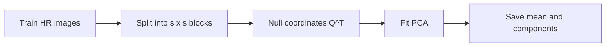
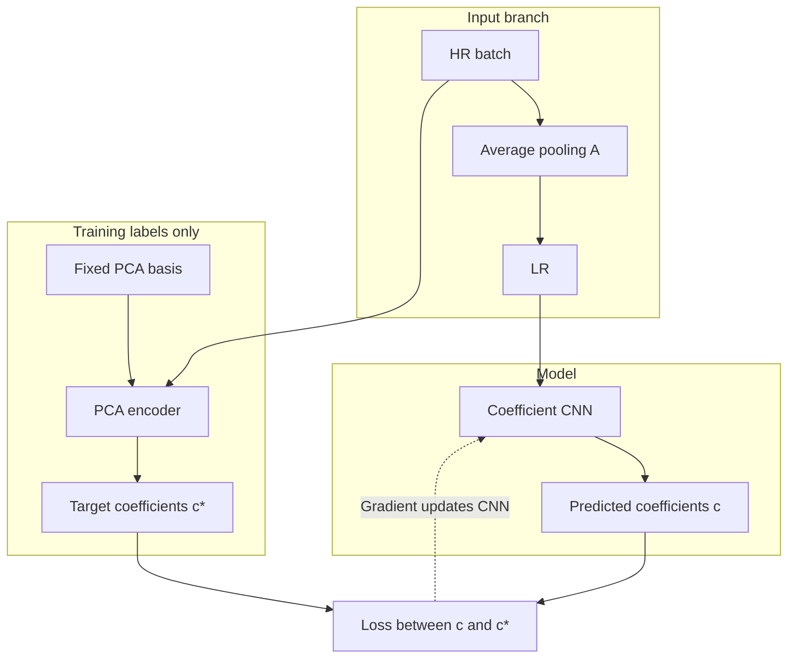
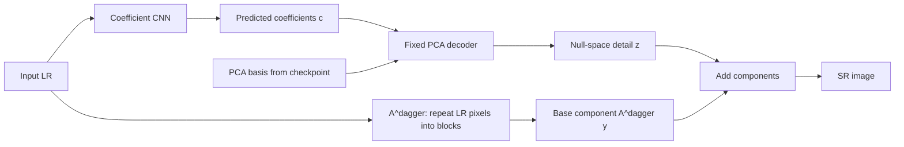

# NuSESR

Null space là plugin tùy chọn qua `model.null_space` trong YAML:

- `true`: head hệ số PCA + decoder average pooling cố định, cần `model.basis`.
- `false`: head Conv + PixelShuffle của IMDN, học trực tiếp ảnh HR bằng image MSE,
  không cần fit PCA. Có thể dùng LR bicubic với `configs/train_div2k_bicubic.yaml`.

Nếu bỏ `null_space`, có `basis` thì dùng PCA (tương thích config cũ), không có
`basis` thì dùng miền ảnh. Train, resume và test đều hỗ trợ hai chế độ;
checkpoint lưu chế độ model. Xem [cấu hình chi tiết](docs/configuration.md).

Dataset tạo LR độc lập theo `data.resize.method`. Có thể dùng LR bicubic với
model PCA average pooling qua `configs/train_div2k_nullspace_bicubic.yaml`.
Model luôn bảo đảm `average_pool(SR) == LR`; không yêu cầu `average_pool(HR) == LR`.

**Siêu phân giải ảnh bằng cách dự đoán hệ số PCA và tổng hợp trực tiếp trong null space.**

NuSESR là project nghiên cứu bằng PyTorch. Mạng nhận ảnh độ phân giải thấp (LR), dự đoán các bản đồ hệ số PCA, rồi dùng decoder cố định để tạo thành phần chi tiết thuộc null space của toán tử đo. Ảnh SR được tạo bằng cách cộng chi tiết này với thành phần tái tạo từ LR.

Thiết lập ban đầu là **SR ×4, ảnh RGB và non-overlapping average pooling**. Project cung cấp dataloader DIV2K, fit PCA, huấn luyện, resume và đánh giá; chưa có kết quả huấn luyện hoặc benchmark trên DIV2K.

## Kiến trúc

```text
                           ┌─ Coefficient CNN ─ c ─ PCA decoder ─ z ─┐
LR y ──────────────────────┤                                         ├─ cộng ─ SR
                           └─ Lặp pixel theo block ─ A†y ────────────┘
```

Mạng dự đoán `C × k` bản đồ hệ số ở độ phân giải LR. Decoder tổng hợp `z` trực tiếp từ cơ sở null space; không cần chiếu ảnh đầu ra của backbone trong inference.

| Thành phần | Vai trò |
|---|---|
| `NuSESR` | Ghép predictor, PCA decoder và thành phần `A†y` |
| `IMDN` | Predictor coefficient miền LR, dựa trên sáu IMDB của kiến trúc IMDN |
| `BlockNullSpacePCA` | Fit PCA offline, encode nhãn, decode chi tiết, lưu/nạp basis |
| `AveragePoolSR` | Toán tử đo average pooling và giả nghịch đảo lặp pixel |
| `coefficient_image_mse` | Loss hệ số chuẩn hóa theo số pixel HR |
| `DIV2KDataset` | Đọc HR, crop/augment, sinh LR bằng average pooling |
| `make_loader` / `SRSample` | Giao diện input/target chung cho các dataset |

Tên lớp mô hình là **`NuSESR`**; tên package Python là **`nullspaceSR`**.

## Luồng chạy model

### 1. Chuẩn bị PCA

PCA được fit offline chỉ từ HR của train split. Basis được lưu lại và giữ cố định khi train.



### 2. Huấn luyện predictor

HR tạo LR đầu vào và hệ số mục tiêu `c*`. CNN chỉ nhận LR.



### 3. Suy luận

Inference chỉ cần LR và basis trong checkpoint; không cần HR hay PCA encoder.



## Cơ sở toán học

Với hệ số phóng đại $s$, mỗi block HR có $q=s^2$ phần tử trên mỗi kênh. Toán tử đo và giả nghịch đảo là:

$$
A_b=\frac{1}{q}\mathbf{1}^{\top},\qquad A_b^\dagger=\mathbf{1}.
$$

Dựng cơ sở Helmert trực chuẩn $Q\in\mathbb{R}^{q\times(q-1)}$ thỏa:

$$
\mathbf{1}^{\top}Q=0,\qquad Q^{\top}Q=I.
$$

PCA được fit riêng cho từng kênh trên tọa độ $Q^{\top}x_b$ từ **HR training data**, thu mean $m$ và các hướng $V_k$. Với hệ số mạng dự đoán $c_\theta(y)_b$:

$$
z_b=Q\bigl(m+V_kc_\theta(y)_b\bigr),\qquad
\hat{x}_b=A_b^\dagger y_b+z_b.
$$

Do $A_bQ=0$, mọi hệ số đều tạo chi tiết có trung bình block bằng 0. Vì vậy $A_b\hat{x}_b=y_b$ về toán học; triển khai số chỉ chính xác tới sai số dấu phẩy động.

Decoder tính trước $U_k=QV_k$ và $\mu=Qm$, nên inference chỉ tổng hợp $z_b=\mu+U_kc_b$. Q, mean và basis được lưu bằng buffers và giữ cố định khi huấn luyện predictor.

Ở ×4, null space có **15 chiều cho mỗi block và mỗi kênh**. Với RGB, rank `k=8`, head xuất **24 kênh hệ số**. Đây là PCA theo block dùng chung giữa các vị trí, không phải PCA toàn ảnh.

## Cấu trúc repository

```text
.
├── README.md
├── LICENSE
├── .gitignore
├── pyproject.toml
├── fit_pca.py                         # CLI fit PCA offline
├── train.py                           # CLI huấn luyện / resume
├── test.py                            # CLI đánh giá checkpoint
├── configs/                          # Cấu hình PCA/train/test
├── scripts/                           # Script fit_pca.sh, train.sh, test.sh
├── docs/                             # Hướng dẫn package và data contract
├── examples/smoke_sr.py               # Demo synthetic và một bước train
├── tests/                            # Kiểm tra toán học và pipeline
├── nullspaceSR/                   # Package Python
    ├── models/backbonSR.py            # NuSESR
    ├── models/coefficient_cnn.py      # Predictor mẫu
    ├── operators/                    # A và A†
    ├── data/                         # Dataset, contract, registry, loader
    ├── engine.py                     # Training epoch trên batch chung
    ├── fit_pca.py                     # Fit PCA và provenance metadata
    ├── evaluation.py                 # Oracle / prediction error decomposition
    ├── metrics.py                    # RGB MSE, PSNR, SSIM, LPIPS
    ├── utils.py                      # Seed, YAML, checkpoint, JSON/CSV/PNG
    ├── patches.py                    # Block extraction và pixel shuffle
    ├── pca.py                        # Q, PCA fitting và decoder
    └── losses.py                     # Loss hệ số
```

## Cài đặt và chạy

Yêu cầu **Python ≥ 3.10** và **PyTorch ≥ 2.1**. Chạy các lệnh sau từ thư mục gốc repository:

```bash
python -m pip install -e .
python examples/smoke_sr.py
python -m unittest discover -s tests
```

Demo fit PCA trên dữ liệu synthetic, kiểm tra null-space consistency, phân rã lỗi và thực hiện một bước tối ưu predictor. Bộ tests kiểm tra cơ sở Q, trường hợp covariance thiếu hạng, decoder full rank, lưu/nạp basis và đường forward không dùng phép chiếu.

`configs/sr.yaml` là đặc tả kiến trúc cho demo. Pipeline DIV2K đọc ba cấu hình riêng: `pca_div2k.yaml`, `train_div2k.yaml`, `test_div2k.yaml`.

## Pipeline DIV2K

Chuẩn bị hai thư mục HR trực tiếp như sau; không cần tải LR bicubic:

```text
data/
├── DIV2K_train_HR/    # Ảnh HR train
│   ├── 0001.png
│   └── ...
└── DIV2K_valid_HR/    # Ảnh HR validation
    ├── 0801.png
    └── ...
```

Chỉnh đường dẫn và ngân sách huấn luyện trong `configs/*_div2k.yaml`. Mọi đường dẫn tương đối trong YAML được tính từ thư mục gốc repository. Các entry point tự định vị thư mục này, kể cả khi chạy từ thư mục khác. Từ thư mục gốc repository:

```bash
# 1. Fit decoder chỉ bằng train HR.

python fit_pca.py --config configs/pca_div2k.yaml

# 2. Huấn luyện predictor, giữ decoder cố định.
python train.py --config configs/train_div2k.yaml

# 3. Đánh giá checkpoint tốt nhất trên validation.
python test.py --config configs/test_div2k.yaml
```

PowerShell and Linux launcher scripts run project commands from the repository root.

```powershell
# Fit PCA if requested, then train.
.\scripts\train.ps1 -FitPca

# Resume from a checkpoint.
.\scripts\train.ps1 -ResumeFrom runs/nusesr_x4_k8/last.pt

# Evaluate the default best checkpoint.
.\scripts\test.ps1

# Override checkpoint, HR folder, output, or save reconstructed images.
.\scripts\test.ps1 -Checkpoint runs/nusesr_x4_k8/epoch_0100.pt -HrDir data/DIV2K_valid_HR -SaveImages
```

From the repository root on Linux, run:

```bash
bash scripts/fit_pca.sh
bash scripts/train.sh
bash scripts/test.sh
```


The scripts use the default configs under `configs/`; edit the YAML files to change paths or settings.

### Weights & Biases

Training and evaluation configs enable W&B logging by default. Install the
optional dependency and authenticate once before running:

```bash
python -m pip install -e '.[wandb]'
wandb login
bash scripts/train.sh
bash scripts/test.sh
```

Training logs batch and epoch loss, learning rate, and validation metrics. It
also logs a train LR/SR/HR preview every batch and up to four validation
SR/HR pairs after each validation. Test runs log summary metrics and a per-image
metrics table. Runs use the `NuSE-SR` project by default; change
`logging.project`, `logging.entity`, `logging.name`,
`logging.mode`, or `logging.tags` in the relevant YAML config. Set
`logging.enabled: false` to disable W&B while keeping local CSV/JSON outputs.

Sau khi cài package, cũng có thể dùng `nusesr-fit-pca`, `nusesr-train`, `nusesr-test`. Tham số CLI ghi đè giá trị YAML; xem các lựa chọn với `--help`.

### Dataloader

Mọi dataset trả sample gồm `input`, `target`, `id`, `meta`, `extras`; loader stack tensor và giữ metadata theo từng sample. Train/PCA/test dùng chung schema. Chọn dataset mới bằng `train_dataset`/`val_dataset`/`test_dataset` và kwargs constructor trong YAML. Xem [giao diện dữ liệu và cách thêm dataset](docs/data_contract.md).

Train dùng crop HR ngẫu nhiên (mặc định 256×256), flip/rotate và `repeat` lượt lấy mẫu cho mỗi ảnh trong mỗi epoch. LR được tạo sau augmentation bằng `avg_pool2d`. Sampling dựa trên seed, epoch và index; `workers=0` là cấu hình khởi đầu dùng được trên Windows.

Configure on-the-fly LR generation under `data.resize`: `method`, `size: [height, width]`, and `antialias`. See [experiment configuration](docs/configuration.md).

Validation/test dùng toàn ảnh, cắt phần dư ở cạnh dưới/phải để kích thước chia hết cho scale, không resize. Batch size luôn bằng 1 vì các ảnh có kích thước khác nhau. `test.py` cần HR để tính metric; nếu đánh giá test độc lập, trỏ `--hr-dir` tới thư mục HR tương ứng. Cấu hình mẫu hiện đánh giá DIV2K validation, không phải test độc lập.

### Checkpoint và resume

```bash
python train.py --config configs/train_div2k.yaml --resume runs/nusesr_x4_k8/last.pt
```

`last.pt` lưu model, PCA buffers, optimizer, scheduler, trạng thái RNG và lịch sử. `best.pt` được chọn theo RGB PSNR trung bình từng ảnh validation. Checkpoint theo epoch được lưu mỗi `checkpoint_every` epoch. Resume tiếp tục từ đầu epoch kế tiếp và yêu cầu giữ nguyên cấu hình huấn luyện, basis và danh sách ảnh; không hỗ trợ khôi phục giữa một epoch. Không cần file basis ngoài để chạy `test.py` vì checkpoint mô hình đã chứa decoder.

Thư mục run chứa `config.json`, `manifest.json`, `history.json` và metric validation theo epoch. File `basis.pt.json` ghi cách fit, danh sách ảnh train, phổ eigenvalue, EVR và hash basis.

### Metric và đầu ra

Đánh giá xuất `metrics.json` và `per_image.csv`, gồm RGB PSNR/SSIM/MSE và LPIPS. Nhánh PCA còn có oracle PSNR, truncation MSE, coefficient prediction error, consistency và sai lệch phân rã lỗi. Các metric chất lượng được lấy trung bình từng ảnh; `global_pixel_mse` được tính theo tổng số pixel. DC và sai lệch phân rã được tổng hợp bằng giá trị lớn nhất.

PSNR/SSIM đo ảnh float RGB nguyên trạng, mặc định `shave=0`, không clamp hoặc lượng tử hóa. SSIM dùng Gaussian window 11×11 (sigma 1.5), valid convolution và population covariance; ảnh nhỏ dùng window lẻ phù hợp. Border shave chỉ áp dụng cho metric chất lượng; phân rã lỗi luôn đo trên toàn ảnh.

LPIPS mặc định bật trong validation/test, dùng AlexNet pretrained (v0.1), clamp về `[0,1]` rồi chuẩn hóa `[-1,1]`, cùng border shave và không resize. Cài bằng `python -m pip install -e ".[metrics]"`; lần đầu sẽ tải trọng số AlexNet. PSNR/SSIM càng cao càng tốt, LPIPS càng thấp càng tốt. Có thể tắt bằng `--no-lpips` hoặc `evaluation.lpips: false`; ảnh sau shave cần ít nhất 32×32 cho LPIPS. Chi tiết xem [cấu hình](docs/configuration.md).

```bash
python test.py --config configs/test_div2k.yaml --save-images
```

PNG xuất ra được clamp/round để xem ảnh; metric luôn đo trước bước này. Dataset, basis, run, kết quả và môi trường kiểm tra được bỏ qua bởi `.gitignore`.

## Sử dụng mô hình

Ví dụ tối thiểu với dữ liệu synthetic:

```python
import torch
from nullspaceSR import BlockNullSpacePCA, NuSESR, IMDN

scale, rank, channels = 4, 8, 3
train_hr_batches = [torch.rand(2, channels, 32, 32) for _ in range(3)]

# Fit một lần offline; thay bằng HR loader từ train split khi dùng dữ liệu thật.
pca = BlockNullSpacePCA.fit(train_hr_batches, scale=scale, rank=rank)
pca.save("basis.pt")

predictor = IMDN(channels=channels, rank=rank, width=64)
model = NuSESR(predictor, pca)

hr = torch.rand(1, channels, 32, 48)
lr = model.operator(hr)
model.eval()
with torch.no_grad():
    sr = model(lr)
    null_detail = model.predict_null(lr)

print(lr.shape, sr.shape)
# [1, 3, 8, 12] -> [1, 3, 32, 48]
```

Predictor ở ví dụ trên chưa được huấn luyện. Consistency được bảo đảm bởi cấu trúc decoder; chất lượng chi tiết phụ thuộc vào dữ liệu, rank và predictor đã học.

Nạp lại decoder bằng `BlockNullSpacePCA.load("basis.pt")`. File basis chỉ lưu decoder; trọng số predictor cần được lưu riêng hoặc cùng `model.state_dict()` trong checkpoint mô hình. Khi dùng GPU hoặc đổi precision, di chuyển cả model và inputs về cùng device/dtype.

## Huấn luyện predictor

Từ HR training batch, tạo LR bằng đúng toán tử `A` và encode nhãn hệ số:

```python
from nullspaceSR import coefficient_image_mse

model.train()
optimizer = torch.optim.Adam(model.predictor.parameters(), lr=1e-3)

lr = model.operator(hr)
target = model.decoder.encode_hr(hr)
predicted = model.predict_coefficients(lr)
loss = coefficient_image_mse(predicted, target, channels=channels, scale=scale)

optimizer.zero_grad()
loss.backward()
optimizer.step()
```

Với basis trực chuẩn và cặp `lr=A(hr)`, sai số được phân rã thành:

$$
\mathrm{MSE}_{image}=\mathrm{MSE}_{truncation}
+\frac{\mathrm{SSE}_{coefficients}}{\text{số phần tử HR}}.
$$

Nếu dùng coefficient MSE thông thường, hệ số quy đổi sang đóng góp image MSE là $k/s^2$. Rank nhỏ tạo truncation error mà predictor không thể bù khi decoder được cố định.

## Thay backbone

Lớp `IMDN` giữ stem, sáu Information Multi-Distillation Blocks (IMDB), contrast-aware channel attention, feature fusion và LR residual của IMDN gốc. Chỉ output head được thay: xuất `C*k` kênh hệ số ở cùng độ phân giải LR, không pixel-shuffle thành RGB ([IMDN source](https://github.com/Zheng222/IMDN/blob/master/model/architecture.py)).


Bạn có thể thay `IMDN` bằng mạng của mình. Predictor cần tuân theo giao diện:

```text
Input:  [B, C, H_LR, W_LR]
Output: [B, C*k, H_LR, W_LR]
```

Predictor có thể khai thác ngữ cảnh giữa các block. Ràng buộc null space nằm ở decoder cuối, nên backbone không cần tự bảo đảm trung bình block bằng 0. Constructor của mô hình là `NuSESR(predictor, decoder)`; `RNDModel` được giữ làm alias tương thích.

## Quy trình thực nghiệm

1. Fit PCA bằng HR **train only**, dùng streaming moments FP64.
2. Giữ basis cố định, quét rank và đo oracle truncation error trên validation.
3. Huấn luyện predictor; đo riêng truncation error và coefficient prediction error.
4. So sánh với DCT, random null basis và full-rank null-space output.
5. Đo chất lượng ảnh, latency E2E và bộ nhớ trên cùng thiết bị trước khi kết luận về hiệu quả.


## Phạm vi và giới hạn

- Model PCA cố định dùng average pooling theo block không chồng lấn, độc lập cách sinh LR. Với LR bicubic, `average_pool(SR) == LR` vẫn đúng; sai lệch `average_pool(HR) - LR` tạo phần lỗi không thể loại bỏ trong ràng buộc này và được báo cáo bằng `measurement_mismatch_mse`.
- Kích thước HR phải chia hết cho scale; dữ liệu thường dùng float trong `[0,1]`.
- Không dùng HR validation/test để fit mean hoặc basis. Validation có thể chọn hyperparameter; test dành cho đánh giá cuối.
- Augment HR trước rồi tạo LR và encode hệ số, vì flip/rotate còn thay đổi thứ tự pixel bên trong block.
- Mô hình không clamp ảnh đầu ra; clamp có thể phá consistency và đẳng thức phân rã lỗi.
- Giảm số hệ số chưa tự chứng minh giảm latency. Cần đo cả predictor, decoder và chi phí xuất ảnh.

## Trạng thái phát triển

Đã có core model, analytic null basis, PCA fitter/decoder, dataloader DIV2K, vòng train/resume, RGB metrics, evaluator và tests. Benchmark edge và các backbone nâng cao là các bước tiếp theo. Kết quả chạy trên fixture nhỏ chỉ kiểm tra tính đúng của pipeline, không thay cho thí nghiệm DIV2K.

Thông tin giấy phép nằm trong [LICENSE](LICENSE).
